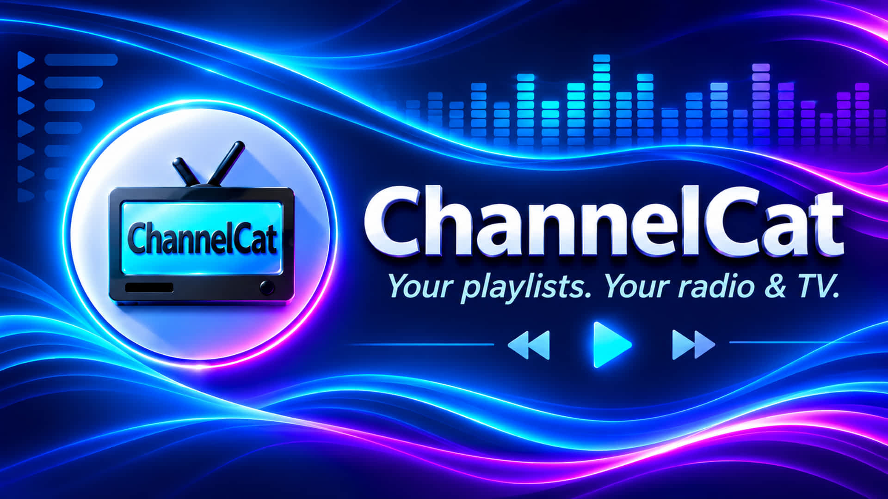

  

   
  
# ChannelCat for Kodi 

ChannelCat is a fork of [TVS Player](https://github.com/gnardelli/tvsplayer-kodi)  
Play **your own M3U / M3U8 playlists** (from a web address or a file) and **thousands of free
radio stations** from the open [Radio Browser](https://www.radio-browser.info) directory, by country
and genre. Channels are sorted by category with logos and search, dead links are skipped
automatically, and favourites can be reordered.

✨**Improvements made from the original:**
- Add free radio stations by genre
- Search Internet Radio Station
- Export playlist as a M3U file
- Added inputstream adaptive support for video links

ChannelCat is only a player: it does not include or provide any TV channels or playlists.
Add only content you have the right to use.

Download here: [plugin.video.channelcat-1.1.2.zip](https://github.com/dobbelina/channelcat-kodi/releases/latest/download/plugin.video.channelcat-1.1.2.zip)

## Use

- **Playlists → Add M3U playlist (web address / file)**, or **Add free radio stations by country or genre or search individual station**
- **TV** and **Radio**: channels by category; **Search** across all playlists
- To reload a playlist that changed online: **Playlists → your playlist → Refresh**
- Only the channels of one playlist: **Playlists → your playlist → TV channels / Radio stations of this playlist**
- In 9 languages (Kodi's language): English, Italian, French, German, Spanish, Portuguese, Polish, Chinese, Japanese
- When no link answers because the internet is slow or missing, a message says so

## License

GPL-2.0-or-later, see [LICENSE.txt](LICENSE.txt).
